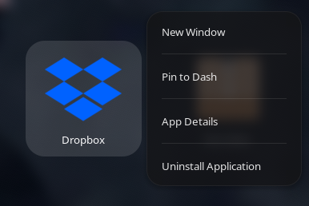

# SidDelete Application Uninstaller

[](https://www.gnome.org/)
[](LICENSE)
[](https://extensions.gnome.org/)

SidDelete adds **Uninstall Application** to the right-click menu of applications
in the GNOME application drawer. It works for normal application icons and for
applications opened from GNOME app folders.

The extension identifies the package that owns the application's `.desktop`
file, asks for confirmation, revalidates the package, and invokes the native
package manager. It does not construct or execute shell commands.

## Screenshots

<p align="center">
  
  
</p>

The screenshots show the feature in both supported GNOME drawer contexts:

- An application in the main application grid.
- An application opened inside a GNOME application folder.

## Features

- Adds a native GNOME Shell context-menu action.
- Shows the application name, package name, package source, and a destructive-action warning.
- Rechecks package ownership after confirmation and immediately before removal.
- Uses Polkit for system-level package operations.
- Supports user and system Flatpak installations.
- Refuses AppImages, manually-created launchers, and unknown package ownership.
- Uses gettext translations, including Brazilian Portuguese (`pt_BR`).
- Supports GNOME Shell 45 through 51 as declared in `metadata.json`.

## Supported Package Sources

| Platform or source | Ownership lookup | Removal operation | Authentication |
| --- | --- | --- | --- |
| Fedora and RPM systems | `rpm -qf` | `pkexec dnf remove` | Polkit |
| Debian, Ubuntu, Pop!_OS | `dpkg-query -S` | `pkexec apt-get remove` | Polkit |
| Arch, CachyOS, Manjaro | `pacman --query --owns` | `pkexec pacman --remove` | Polkit |
| Flatpak | Flatpak export path and `flatpak info` | `flatpak uninstall` | Flatpak/Polkit |
| Snap | Snap export path and `snap list` | `pkexec snap remove` | Polkit |

The package manager is selected from the verified owner of the desktop file,
not from the application name or a user-provided command.

## Security Model

- Only trusted system, Flatpak, and Snap desktop-file locations are considered.
- Package ownership is resolved through the native package database.
- The package is resolved again after the user confirms removal.
- Package identifiers are validated before being passed as process arguments.
- System removal uses `pkexec` and the system Polkit agent.
- No shell interpolation, wildcard expansion, or arbitrary user command is used.
- Dependency cleanup is not requested automatically.
- Unsupported launchers remain unavailable instead of being deleted heuristically.

## Installation

### GNOME Extensions

The extension is prepared for submission to [extensions.gnome.org](https://extensions.gnome.org/).
After approval, install it from the GNOME Extensions website.

### Manual ZIP Installation

Download the latest release archive, then install it with:

```sh
gnome-extensions install --force sid-delete@josasidyr.shell-extension.zip
gnome-extensions enable sid-delete@josasidyr
```

On Wayland, log out and log in again if GNOME Shell does not reload the new
extension immediately.

### Build From Source

```sh
git clone https://github.com/JosaSidyr/sid-delete.git
cd sid-delete
make check
make package
make install
```

The review archive is generated at:

```text
dist/sid-delete@josasidyr.shell-extension.zip
```

The upload archive contains only the runtime files required by GNOME Shell:
`metadata.json`, `extension.js`, and compiled gettext catalogs.

## Requirements

- GNOME Shell 45 or newer.
- GJS and the GNOME Shell extension runtime.
- `gettext` and `msgfmt` to build translations.
- `pkexec` and an active Polkit authentication agent for system packages.
- At least one supported package manager for the applications being removed.

The implementation is currently validated on GNOME Shell 51. Older declared
versions should be tested on their respective distributions before release.

## Development

```sh
make check       # Validate translations, JavaScript, and metadata
make package     # Build the minimal GNOME review archive
make install     # Install the archive locally
make uninstall   # Remove the local extension
```

See the detailed design notes in [`docs/architecture.md`](docs/architecture.md)
and the test matrix in [`docs/testing.md`](docs/testing.md).

## Project Layout

```text
extension.js                         Runtime GNOME Shell extension
metadata.json                        GNOME Extension metadata
locale/pt_BR/.../sid-delete.po       Brazilian Portuguese source catalog
Makefile                             Check, package, install, and uninstall tasks
docs/architecture.md                 Runtime and security architecture
docs/testing.md                      Validation and distribution test matrix
CONTRIBUTING.md                      Contribution workflow
RELEASING.md                         GNOME Extensions release checklist
screenshots/                         Project screenshots used by this README
```

## Reporting Issues

Include the GNOME Shell version, distribution, package source, and the output
of:

```sh
gnome-extensions show sid-delete@josasidyr
journalctl --user -b -u gnome-shell --no-pager
```

Do not include authentication credentials or private package-manager logs.

## Contributing

Bug reports, distribution-specific test results, and pull requests are
welcome. Read [`CONTRIBUTING.md`](CONTRIBUTING.md) before changing package
manager handling or destructive-operation logic.

## License

GPL-3.0-or-later. See [`LICENSE`](LICENSE).
